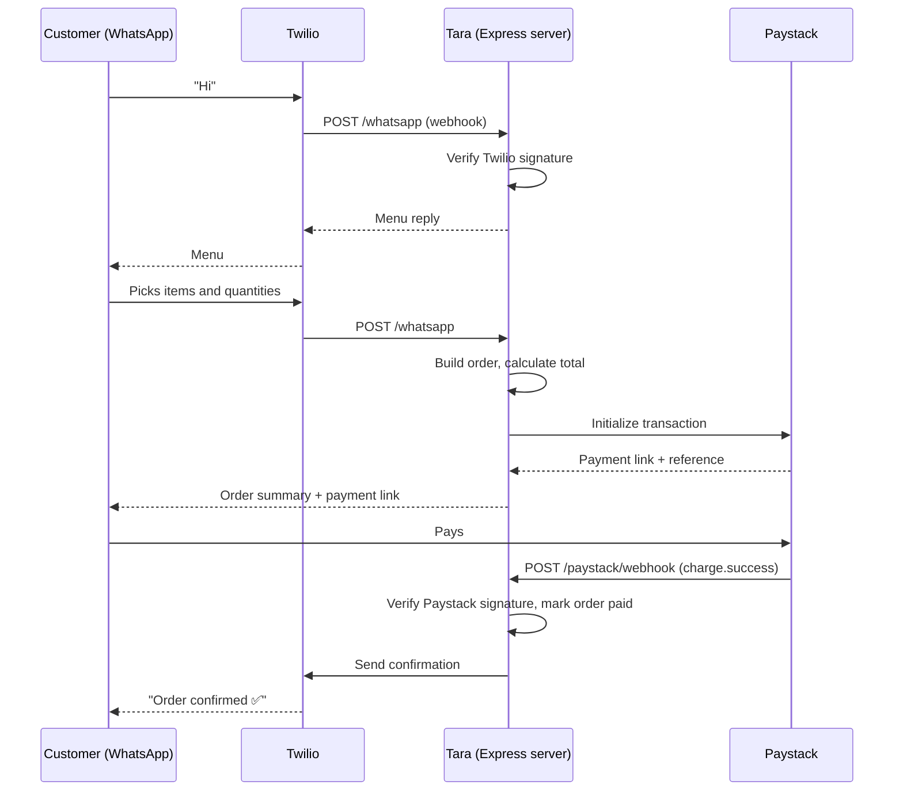

# Tara: WhatsApp Ordering Bot

A reference implementation that lets customers browse, order and pay entirely inside WhatsApp.

I built Tara to show a client the full flow end to end. A customer messages a business's WhatsApp number, the bot turns the conversation into an order, takes payment through **Paystack**, and confirms the order back in the chat. It's built in JavaScript (Node.js) on the **Twilio WhatsApp API**, and it's driven entirely by webhooks.

---

## Why this exists

Many small businesses in Nigeria already sell through WhatsApp, but by hand. They reply to every message, take orders in chat, send bank details and check transfers themselves. That doesn't scale, and orders get lost.

Tara automates that loop while keeping customers in the app they already use.

---

## How it works



### The conversation flow

1. **Greeting:** any message from a new customer returns the menu.
2. **Ordering:** the customer replies with item numbers and quantities, and the bot builds a cart.
3. **Confirmation:** the bot sends an order summary and total.
4. **Payment:** the bot generates a Paystack payment link tied to that order's reference.
5. **Fulfilment:** when Paystack confirms the payment, the customer gets a confirmation and the business is notified.

---

## Key technical details

- **Webhook-driven, both ways.** Incoming WhatsApp messages arrive as Twilio webhooks, and payment results arrive as Paystack webhooks. There is no polling.
- **Signatures are verified.** Twilio requests are checked against the `X-Twilio-Signature` header, and Paystack events against `x-paystack-signature` (HMAC SHA-512). Unverified requests are rejected.
- **Payment status comes from Paystack, not the customer.** An order is only marked paid when the verified `charge.success` webhook arrives, never because the customer says they've paid.
- **Duplicate events are safe.** Each payment carries a unique reference, so a repeated Paystack webhook can't confirm the same order twice.
- **Conversation state is per customer,** keyed on the customer's WhatsApp number, so several customers can order at once.

---

## Getting started

### Prerequisites

- Node.js 18+
- A Twilio account with the WhatsApp Sandbox (or an approved WhatsApp sender)
- A Paystack account (test keys are fine)
- ngrok, or any tunnel, for local testing

### Setup

```bash
git clone https://github.com/TheShola/whatsapp-nlb.git
cd whatsapp-nlb
npm install
cp .env.example .env   # then fill in the values below
npm start
```

### Environment variables

| Variable | Description |
|---|---|
| `TWILIO_ACCOUNT_SID` | From the Twilio console |
| `TWILIO_AUTH_TOKEN` | From the Twilio console; also used to verify webhook signatures |
| `TWILIO_WHATSAPP_NUMBER` | For example, `whatsapp:+14155238886` (sandbox) |
| `PAYSTACK_SECRET_KEY` | From the Paystack dashboard; also used to verify webhook signatures |
| `PUBLIC_URL` | Your public server URL, used for callbacks |
| `PORT` | Defaults to `3000` |

> Never commit `.env`. It's in `.gitignore`.

### Connect the webhooks

1. Run `npx ngrok http 3000` and copy the HTTPS URL.
2. **Twilio:** set the WhatsApp Sandbox "When a message comes in" URL to `https://<your-url>/whatsapp`.
3. **Paystack:** set the webhook URL in Settings → API Keys & Webhooks to `https://<your-url>/paystack/webhook`.
4. Message the sandbox number from WhatsApp.

---

## Project structure

```
src/
  server.js        Express app and routes
  whatsapp.js      Incoming message handler and replies
  conversation.js  Per-customer state (menu → cart → checkout)
  paystack.js      Payment initialization and webhook handling
  menu.js          Product catalogue
```

---

## What I'd add next

- A persistent database for orders and conversation state (currently in memory)
- An admin view so the business can see and fulfil orders
- WhatsApp interactive list and button messages instead of numbered replies
- Delivery address capture and delivery fee calculation
- Order status updates (dispatched, delivered) sent back to the customer

---

## Author

**Shola Abimbola** · [LinkedIn](https://linkedin.com/in/shola-abimbola) · [GitHub](https://github.com/TheShola)

## License

MIT

A production-ready WhatsApp order bot for Tin and Tain snacks.
Built with **Node.js + Express**, powered by **Claude AI (Tara)**, with **Chowdeck** delivery fee checks and **Paystack** payments.

---

## Architecture

```
Customer (WhatsApp)
       ↕  Twilio
  This Server
       ├──→ Claude API        Tara takes the order conversationally
       ├──→ Redis              Persists conversation + order state per customer
       ├──→ Chowdeck API      Gets exact delivery fee for customer's address
       └──→ Paystack API      Initialises payment + verifies webhook events

Paystack (after payment)
       ↕  POST /webhook/paystack
  This Server
       ├──→ Paystack verify   Double-checks payment before acting
       ├──→ Twilio            Sends "payment confirmed" WhatsApp message
       └──→ Chowdeck API      Dispatches rider  (Step 4)
```

### Order Flow

```
Customer says hi
  → Tara greets + shares menu
  → Customer picks items
  → Customer gives delivery address
  → Server calls Chowdeck /delivery/fee  (silent)
  → Tara presents: items subtotal + delivery fee = grand total
  → Customer confirms
  → Paystack transaction initialised → payment link sent on WhatsApp
  → Customer pays on Paystack's hosted page
  → Paystack fires charge.success webhook
  → Server verifies payment with Paystack directly
  → Customer gets "payment confirmed" WhatsApp message
  → (Step 4) Chowdeck rider dispatched automatically
  → (Step 5) Live status updates as rider moves
```

---

## Project Structure

```
tin-and-tain-bot/
├── src/
│   ├── index.js                  Express server + body parsing + graceful shutdown
│   ├── config/
│   │   └── bot.js                Menu + Tara's system prompt
│   ├── routes/
│   │   ├── webhook.js            POST /webhook/whatsapp — WhatsApp message handler
│   │   ├── chowdeck.js           POST /webhook/chowdeck — Chowdeck delivery handler
│   │   └── paystack.js           POST /webhook/paystack — payment confirmation handler
│   └── services/
│       ├── redisClient.js        Redis connection with auto-reconnect
│       ├── sessionStore.js       Persists conversation + order state in Redis
│       ├── claudeService.js      Claude API — generates Tara's replies
│       ├── twilioService.js      Sends WhatsApp messages + validates Twilio signatures
│       ├── chowdeckService.js    Delivery fee + rider dispatch (🟡 mocked — Step 4)
│       └── paystackService.js    ✅ Real — initialise, verify, webhook signature check
├── docker-compose.yml
├── Dockerfile
├── railway.toml
├── render.yaml
├── .env.example
└── package.json
```

---

## Local Development

### Option A — Docker Compose (recommended)

```bash
cp .env.example .env
# fill in TWILIO_*, ANTHROPIC_API_KEY, PAYSTACK_SECRET_KEY
docker compose up
```

### Option B — Run directly

```bash
brew install redis && brew services start redis
npm install
cp .env.example .env
npm run dev
```

### Environment Variables

| Variable | Where to get it |
|---|---|
| `TWILIO_ACCOUNT_SID` | [console.twilio.com](https://console.twilio.com) → Account Info |
| `TWILIO_AUTH_TOKEN` | Same page |
| `TWILIO_WHATSAPP_FROM` | Twilio sandbox number — `whatsapp:+14155238886` |
| `ANTHROPIC_API_KEY` | [console.anthropic.com](https://console.anthropic.com) |
| `PAYSTACK_SECRET_KEY` | [Paystack Dashboard](https://dashboard.paystack.com/#/settings/developers) → API Keys |
| `PAYSTACK_CALLBACK_URL` | URL to redirect customer after payment (optional) |
| `REDIS_URL` | `redis://localhost:6379` locally — auto-set on Railway/Render |

### Expose locally with ngrok

```bash
ngrok http 3000
```

You'll get two public URLs to register:

| Service | Where to paste the URL |
|---|---|
| `https://xxxx.ngrok.io/webhook/whatsapp` | Twilio sandbox → "When a message comes in" |
| `https://xxxx.ngrok.io/webhook/paystack` | Paystack Dashboard → Settings → Webhooks |

---

## Paystack Webhook Setup

1. Go to [Paystack Dashboard](https://dashboard.paystack.com) → **Settings → API Keys & Webhooks**
2. Under **Webhook URL**, add: `https://yourdomain.com/webhook/paystack`
3. Paystack will send a `charge.success` event to this URL after every successful payment
4. The server verifies the HMAC-SHA512 signature on every request before acting

**Security model:** The webhook handler always calls `verifyTransaction()` to confirm payment directly with Paystack, even after validating the webhook signature. This prevents any replay or spoofed events from triggering rider dispatch.

---

## Deploy

### Railway

```bash
git init && git add . && git commit -m "init"
gh repo create tin-and-tain-bot --private --push
```

1. [railway.app](https://railway.app) → New Project → Deploy from GitHub
2. Add a **Redis** plugin (Railway injects `REDIS_URL` automatically)
3. Add env vars in the dashboard
4. Use the Railway URL for both Twilio and Paystack webhook endpoints

### Render

1. [render.com](https://render.com) → New → Blueprint → connect repo
2. `render.yaml` provisions both the web service and Redis automatically
3. Add env vars, deploy

---

## Order Storage Setup

### Airtable (orders dashboard)

1. Create a free base at [airtable.com](https://airtable.com)
2. Create a table called `Orders` with these columns:

| Column | Type |
|---|---|
| Order ID | Single line text |
| Customer Name | Single line text |
| Phone | Phone number |
| Delivery Address | Long text |
| Items | Long text |
| Subtotal | Currency |
| Delivery Fee | Currency |
| Total Paid | Currency |
| Chowdeck ID | Single line text |
| Status | Single select: Paid, Dispatched, Delivered, Rejected |
| Order Date | Date (include time) |

3. Create a Personal Access Token at [airtable.com/create/tokens](https://airtable.com/create/tokens) with `data.records:read` and `data.records:write` scopes
4. Copy your Base ID from the URL: `airtable.com/appXXXXXXXXX/...`

### Supabase (analytics)

1. Create a free project at [supabase.com](https://supabase.com)
2. Go to **SQL Editor → New Query**, paste the contents of `database/schema.sql` and click **Run**
3. Go to **Settings → API** to get your Project URL and `service_role` key

This creates two tables and three analytics views:
- `daily_revenue` — orders and revenue per day
- `avg_delivery_time` — average dispatch-to-delivered time in minutes
- `top_items` — most ordered products by quantity

---

## Build Roadmap

| Step | Feature | Status |
|------|---------|--------|
| 1 | Twilio webhook + Claude conversation | ✅ Done |
| 2 | Redis session persistence | ✅ Done |
| 3 | Real Paystack payment links + webhook | ✅ Done |
| 4 | Real Chowdeck delivery fee + rider dispatch | ✅ Done |
| 5 | Chowdeck webhooks → live WhatsApp status updates | ✅ Done |
| 6 | Order storage — Airtable + Supabase analytics | ✅ Done |

1. Go to your Chowdeck merchant dashboard → **Settings → Webhooks**
2. Add your webhook URL:
   ```
   https://yourdomain.com/webhook/chowdeck
   ```
3. Chowdeck will fire these events automatically as your rider moves:

| Event | WhatsApp message sent to customer |
|---|---|
| `order.created` | Rider search started |
| `order.assigned` | Rider assigned, heading to kitchen |
| `order.awaiting_pickup` | Rider at kitchen collecting order |
| `order.picked_up` | Rider en route with rider's phone number |
| `order.arrived_at_customer` | Rider is outside — come collect! |
| `order.complete` | Delivered + feedback prompt |

---
